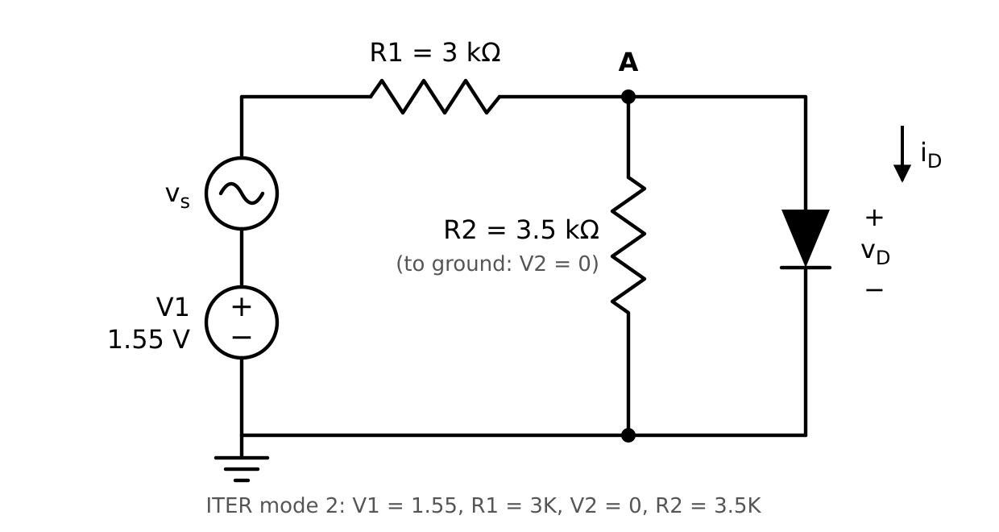

# ITER — Diode bias-point iteration for TI-84 Plus CE

A TI-BASIC program that finds the DC operating point of a diode circuit by iterating the exponential diode model, then gives the small-signal resistance `rd`. It handles a single source and resistor, or a node fed by **two sources through two resistors** (it forms the Thévenin equivalent itself).

一个 TI-84 Plus CE 上的 TI-BASIC 程序：用二极管指数模型迭代求直流工作点，并给出小信号电阻 `rd`。支持“一个电源串一个电阻”，也支持**两个电源各经一个电阻接到同一节点**（程序自己算戴维南等效）。

---

## Features

1. **1 VS + R** — `VS – R – N diodes – ground`
2. **2 TWO SOURCES** — `V1 – R1 – node – R2 – V2`, diodes from the node to ground. Shows `VTH` and `RTH`. For a resistor tied to ground, enter `V2 = 0`.
3. Iteration
   - `VD = VREF + VT·ln(ID / IREF)`
   - `ID = (VTH − N·VD) / RTH`
   - starting from `VD = VREF`, every step is listed (`K, VD, ID`); it stops when ID changes by less than 0.05 µA (max 25 steps)
4. Results: `ID`, `VD` per diode and for the string, voltage across `RTH`, **`rd = VT / ID`**, number of iterations
5. Two-source mode also shows the current **into the node from each source** (positive = into the node) and checks that they add up to `ID`
6. Unit suffixes on every input (same parser as [DIODE](https://github.com/INLEI12138/ti84-diode)): `10K`, `3.5KOHM`, `1MA`, `25MV`, `5V`, `4.7MEG` — `M` is milli, `MEG` is mega
7. Diode parameters default to `N = 1`, `VREF = 0.7 V`, `IREF = 1 mA`, `VT = 25 mV` — just press `ENTER`

## 功能

1. **1 VS + R**：电源 – 电阻 – N 个二极管 – 地
2. **2 TWO SOURCES**：`V1 – R1 – 节点 – R2 – V2`，二极管从节点接到地。会显示 `VTH`、`RTH`。电阻直接接地时，`V2` 输入 `0`。
3. 迭代
   - `VD = VREF + VT·ln(ID / IREF)`
   - `ID = (VTH − N·VD) / RTH`
   - 从 `VD = VREF` 开始，每一步都列出来（`K, VD, ID`）；ID 变化小于 0.05 µA 时停止（最多 25 次）
4. 结果：`ID`、单个二极管和整串的 `VD`、`RTH` 上的压降、**`rd = VT / ID`**、迭代次数
5. 双电源模式还会显示**每个电源流进节点的电流**（正数 = 流进节点），并验证两者之和等于 `ID`
6. 所有输入都能带单位（和 [DIODE](https://github.com/INLEI12138/ti84-diode) 用同一套识别代码）：`10K`、`3.5KOHM`、`1MA`、`25MV`、`5V`、`4.7MEG`。`M` 是毫，`MEG` 才是兆
7. 二极管参数有默认值：`N = 1`、`VREF = 0.7 V`、`IREF = 1 mA`、`VT = 25 mV`，直接按 `ENTER` 即可

---

## Install

1. Send `ITER.8xp` to the calculator with TI Connect CE (or paste `ITER.txt` into a new program named `ITER` and send that).
2. `PRGM` → `ITER` → `ENTER`.

Do not rename the program: the unit parser works by the program calling itself as `prgmITER`.

## 安装

1. 用 TI Connect CE 把 `ITER.8xp` 发送到计算器（或者把 `ITER.txt` 粘贴到 TI Connect CE 编辑器里新建的名为 `ITER` 的程序中，再发送）。
2. 按 `PRGM` → 选 `ITER` → `ENTER`。

不要给程序改名：单位识别功能是靠程序以 `prgmITER` 调用自己实现的。

---

## Examples / 示例

Both results were checked on a TI-84 Plus CE. / 两个例子都在 TI-84 Plus CE 实机上验证过。

**Two sources / 双电源** — 5 V through 5 kΩ and 3 V through 10 kΩ to the diode node
Input / 输入：`2` → `5`, `5K`, `3`, `10K` → `ENTER` ×4

| VTH | RTH | ID | VD | rd | Into node from V1 / V2 |
|---|---|---|---|---|---|
| 4.3333 V | 3333.333 Ω | 1.0894 mA | 0.7021 V | 22.949 Ω | 0.8596 / 0.2298 mA |

**Resistor to ground / 电阻接地** — 1.55 V through 3 kΩ, 3.5 kΩ from the node to ground

For the DC bias point set `vs = 0`. R2 goes to ground, so enter `V2 = 0`. / 求直流工作点时令 `vs = 0`；R2 接地，所以 `V2` 输入 `0`。

Input / 输入：`2` → `1.55`, `3K`, `0`, `3.5K` → `ENTER` ×4

| VTH | RTH | ID | VD | rd | Iterations |
|---|---|---|---|---|---|
| 0.83462 V | 1615.385 Ω | 0.1166 mA | 0.6463 V | 214.4 Ω | 5 |

Here the current from `V2` is −0.1847 mA: it flows out of the node through 3.5 kΩ to ground.
这里 `V2` 那一路电流是 −0.1847 mA，即电流从节点经 3.5 kΩ 流到地。

---

## Notes

- Type letters with `ALPHA`; use the `(−)` key for negative values, not subtraction.
- Use `2ND` `,` (EE) for scientific notation, not the letter E.
- `VR` is the voltage across the Thévenin resistance `RTH`, not across R1 or R2.
- The program stops with `DIODE OFF` if `VTH ≤ N·VREF` at the first step, and `NO CONVERGE` if the current goes negative.
- Variables A–Z, θ, `Str1`, `Str9` are used.

## 注意事项

- 字母用 `ALPHA` 输入；负数用 `(−)` 键，不要用减号。
- 科学计数法用 `2ND` `,`（EE），不要用字母 E。
- `VR` 是戴维南电阻 `RTH` 上的压降，不是 R1 或 R2 上的压降。
- 第一步若 `VTH ≤ N·VREF`，程序显示 `DIODE OFF` 并停止；电流变成负数时显示 `NO CONVERGE`。
- 程序会用到变量 A–Z、θ、`Str1`、`Str9`。

---

## Files / 文件说明

- `ITER.8xp` — program for the calculator / 可直接发送到计算器的程序
- `ITER.txt` — readable source / 可读的源码
- `images/example_circuit.svg`, `.png` — example circuit / 示例电路图

## Related programs / 相关程序

Other TI-84 Plus CE programs by INLEI / INLEI 的其他 TI-84 Plus CE 程序：

| Program / 程序 | Purpose | 用途 |
|---|---|---|
| [AMPCALC](https://github.com/INLEI12138/ti84-ampcalc) | Op-amp (inverting / non-inverting) gain, phase and Bode plot | 运放（反相/同相）增益、相位与 Bode 图 |
| [FILTER](https://github.com/INLEI12138/ti84-filter) | Passive RLC voltage-divider filter response and Bode plot | 无源 RLC 分压滤波器频率响应与 Bode 图 |
| [DIODE](https://github.com/INLEI12138/ti84-diode) | Diode circuits: Shockley, series R, Zener, rectifiers, small-signal rd | 二极管电路：肖克利方程、串联电阻、稳压管、整流、小信号电阻 |
| [ZFORMULA](https://github.com/INLEI12138/ti84-zformula) | Series / parallel RLC impedance formula reference | 串联/并联 RLC 阻抗公式速查 |

## License / 许可证

MIT
